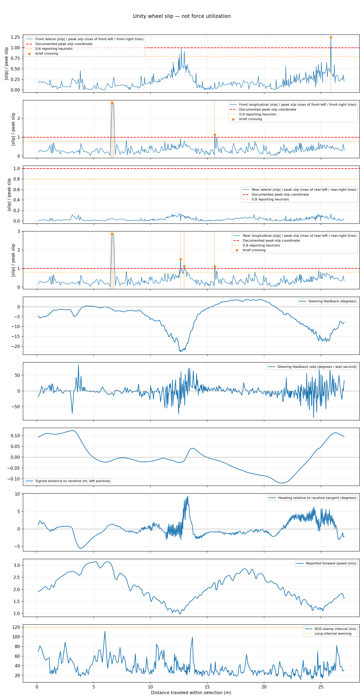
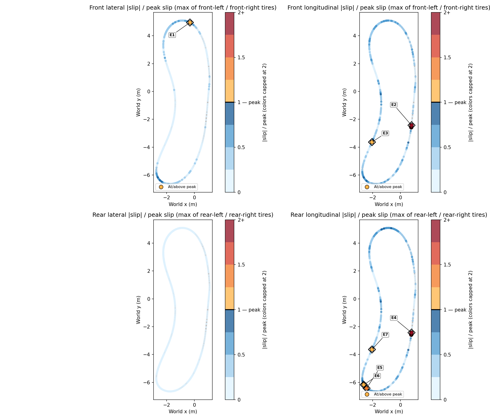

# Unity wheel slip

Primary profiles, maps, peak ratios and crossing events use instantaneous Unity WheelHit telemetry. Both wheels must be grounded; missing native readings remain unavailable. Slip ratios are not tire forces or percentages of available grip.

Selection: {'selection': 'native:2', 'full_lap': True, 'boundary_source': 'native counter bag-receipt times; approximately one frame uncertainty', 'start_native_count': 1, 'end_native_count': 2, 'continuous_geometry': True, 'complete_laps_available': 1}. Distance: 27.04 m.

| Slip metric | Valid samples | Median ratio | P95 ratio | Distance at/above peak |
|---|---:|---:|---:|---:|
| Front lateral |slip| / peak slip (max of front-left / front-right tires) | 430 | 0.180 | 0.534 | 0.144% |
| Front longitudinal |slip| / peak slip (max of front-left / front-right tires) | 430 | 0.332 | 0.652 | 1.341% |
| Rear lateral |slip| / peak slip (max of rear-left / rear-right tires) | 430 | 0.030 | 0.104 | 0.000% |
| Rear longitudinal |slip| / peak slip (max of rear-left / rear-right tires) | 430 | 0.341 | 0.791 | 1.788% |

Raceline tracking: distance-weighted RMS 0.066 m; P95 absolute 0.115 m; maximum 0.123 m; P95 absolute heading error 5.427 degrees.


## Threshold-crossing events

Sustained means at least 0.3 wall seconds and 3 consecutive valid intervals at/above 1. Missing data, segment changes, and long frame intervals break runs. Long-interval crossings are timing-uncertain. This is a persistence heuristic, not proof of saturation.

| Metric | Classification | Intervals | Wall duration (ms) | Peak ratio | Max steering rate (deg/wall s) |
|---|---|---:|---:|---:|---:|
| E1 — front lateral | brief | 1 | 23.888 | 1.245 | 0.000 |
| E2 — front longitudinal | brief | 2 | 105.674 | 2.825 | 14.763 |
| E3 — front longitudinal | brief | 1 | 29.689 | 1.128 | 6.176 |
| E4 — rear longitudinal | brief | 2 | 105.674 | 2.860 | 14.763 |
| E5 — rear longitudinal | brief | 1 | 31.218 | 1.489 | 41.663 |
| E6 — rear longitudinal | brief | 2 | 69.283 | 1.118 | 45.234 |
| E7 — rear longitudinal | brief | 1 | 29.689 | 1.109 | 6.176 |

## Assumptions and limitations

- Unity WheelHit slip is simulator contact telemetry; slip ratios do not measure tire-force utilization.
- Configured peak coordinates: lateral 0.01, longitudinal 0.15. Serialized scene values were inspected separately; runtime overrides are not measured here.
- Instantaneous endpoint slip is used. Both wheels must be grounded for an axle-level ratio. Missing native readings remain unavailable.
- Distance fractions and crossing durations approximate sampled exposure. Shorter peaks between frames can be missed; timing-uncertain events are flagged.
- Lap boundaries come from native counter receipt times, with approximately one frame uncertainty. Ground-truth pose supplies the track projection and tracking error.
- Sustained crossings are a persistence heuristic, not proof of physical saturation.

## Regenerate

```bash
python3 scripts/tire_lap_report.py log/native_slip_isolated_retry_20261101/01_rate_3p2/bag --track-dir tracks/porto_odom_trial --lap native:2 --unity-only --output log/unity_slip_title_update_20261101
```

[Documented threshold source](https://autodrive-ecosystem.github.io/competitions/roboracer-sim-racing-guide-2026/#132-vehicle-dynamics)




